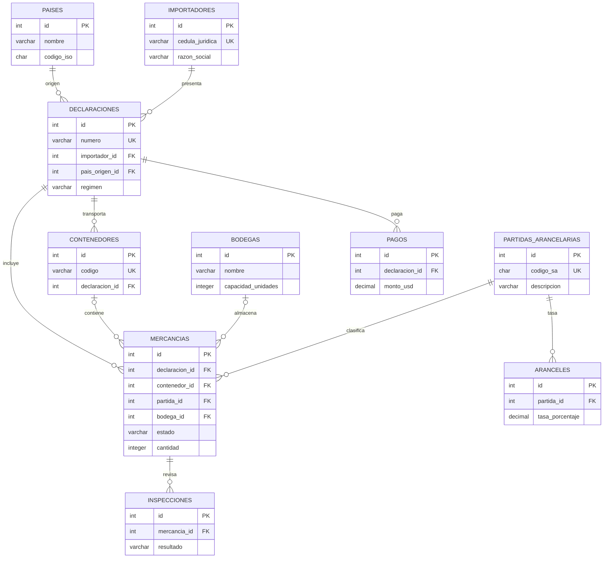

# Diagrama Entidad-Relación (DER) del inventario aduanero

Este es el modelo relacional. Las PK identifican filas y las FK permiten relacionar tablas sin duplicar nombres de países, bodegas o importadores en cada mercancía.

## Relaciones importantes

- **1:N** país → declaraciones: China puede figurar en muchas declaraciones.
- **1:N** importador → declaraciones: una empresa presenta múltiples declaraciones.
- **1:N** declaración → mercancías: una declaración puede tener varias líneas de productos.
- **1:N** bodega → mercancías: una bodega guarda múltiples líneas de inventario.
- **1:N** mercancía → inspecciones: una mercancía puede inspeccionarse varias veces.
- **1:N** declaración → pagos: una declaración puede tener pagos asociados.
- **N:M conceptual**: declaraciones y tipos de partidas, resuelta mediante `mercancias` que vincula ambas y guarda cantidad/valor de cada línea.
- **Restricción adicional**: el contenedor de una línea de mercancía debe pertenecer a la misma declaración, protegida con FK compuesta `(contenedor_id, declaracion_id)`.

## Normalización

- **1FN:** cada valor es atómico, por ejemplo un solo `codigo_iso` por país.
- **2FN:** atributos como razón social dependen de la PK de su tabla (`importadores`), no de un identificador parcial.
- **3FN:** en `mercancias` almacenamos `bodega_id` en vez de repetir el nombre o dirección de cada bodega; país/razón social también viven en sus propias tablas.

**Cómo ver el DER:** abre este `.md` en GitHub o en un editor con soporte Mermaid. Puedes pegar el bloque en https://mermaid.live para descargar un SVG o PNG para tu presentación.

